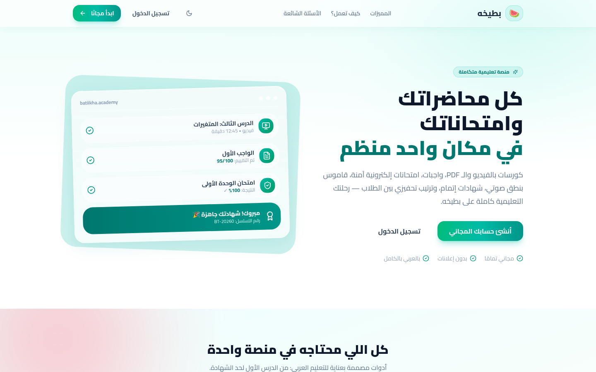

# 🎓 Batiikha Academy

**A full online academy — video courses, auto-graded exams, homework tracking and instant certificates.**

## 📖 Overview

Batiikha is a complete learning platform that walks a student from the first lesson to the certificate. Courses mix video sessions with PDF materials, exams are graded the moment they are submitted, homework is tracked per student, and finishing a course automatically issues a personalized certificate. Parents get their own accounts to follow progress — no phone calls needed.

## ✨ Features

- 🎥 **Courses** with video lessons and downloadable PDF materials
- ⚡ **Exams with instant auto-grading** and clear explanations
- 📝 **Homework assignments** with per-student tracking
- 🏆 **Automatic personalized certificates** on course completion
- 👨‍👩‍👧 **Dedicated parent accounts** and a student community

## 🧱 Tech Stack

`Next.js` · `Education` · `Auth` · `Dashboards` · `Arabic RTL`

## 🌐 Live Product

**Try it now:** [https://bateha-academy.vercel.app/](https://bateha-academy.vercel.app/)

---

Built by **[Hamza Talal](https://github.com/{USERNAME})** — 15-year-old full-stack developer from Egypt

